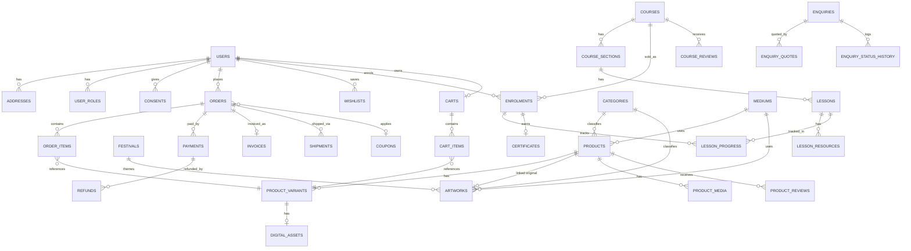

# Art Website — Database Schema

> **Read `00-decisions.md` first.** That file overrides this one where they differ:
> - Payload CMS owns content (products, artworks, courses, festivals, testimonials and so on).
> - Better Auth owns identity.
> - Translations use Payload per-field localisation, not the generic `translations` table.
>
> The `app` schema below stays the reference for **transactional** tables (orders, payments, invoices, enrolments, progress). Required changes are listed in `00-decisions.md` §5.

Conventions used throughout:
- **Primary keys:** `bigint generated always as identity` (no random UUIDs as PKs).
- **Times:** `timestamptz` for all instants.
- **Money:** integer paise in `bigint` columns. This avoids INT4 overflow and never uses floats.
- **Names:** `snake_case` identifiers.
- **Vocabularies:** enums via `CREATE TYPE ... AS ENUM` for small closed lists; lookup tables for lists the admin can extend (mediums, categories).
- **Soft delete:** `deleted_at timestamptz` plus partial unique indexes.
- **Timestamps:** every mutable table has `created_at`/`updated_at`, kept current by a shared `set_updated_at()` trigger.

---

## 1. Entity overview by domain

| Domain | Tables |
|---|---|
| Identity & Access | `users`, `user_roles`, `auth_identities`, `otp_codes`, `addresses`, `consents` |
| Catalog | `categories`, `mediums`, `media`, `product_media`, `artwork_media`, `products`, `product_variants`, `digital_assets`, `artworks`, `festivals` |
| Commerce | `carts`, `cart_items`, `wishlists`, `coupons`, `coupon_redemptions`, `orders`, `order_items`, `payments`, `refunds`, `invoice_counters`, `invoices`, `shipments`, `pincode_serviceability_cache` |
| Learning | `course_categories`, `courses`, `course_sections`, `lessons`, `lesson_resources`, `enrolments`, `lesson_progress`, `lesson_notes`, `certificates` |
| Engagement | `product_reviews`, `course_reviews`, `enquiries`, `enquiry_status_history`, `enquiry_quotes`, `newsletter_subscribers`, `testimonials`, `timeline_milestones`, `stats`, `homepage_blocks` |
| i18n | `translations` |
| Ops | `audit_log`, `webhook_events`, `settings` |

### Mermaid ER diagram (main relationships)



---

## 2. PostgreSQL DDL

### 2.0 Shared helpers

```sql
CREATE SCHEMA IF NOT EXISTS app;

CREATE OR REPLACE FUNCTION app.set_updated_at() RETURNS trigger AS $$
BEGIN
  NEW.updated_at := now();
  RETURN NEW;
END;
$$ LANGUAGE plpgsql;
-- Attach as: CREATE TRIGGER trg_<table>_updated_at BEFORE UPDATE ON <table>
--            FOR EACH ROW EXECUTE FUNCTION app.set_updated_at();
-- Applied to every table below that has an updated_at column (omitted per-table for brevity).

CREATE TYPE user_role AS ENUM ('customer', 'staff', 'artist_admin');
CREATE TYPE auth_provider AS ENUM ('phone_otp', 'google', 'email_password');
CREATE TYPE consent_type AS ENUM ('newsletter', 'whatsapp', 'cookies', 'kids_art_parental');
CREATE TYPE category_scope AS ENUM ('product', 'artwork', 'course');
CREATE TYPE product_type AS ENUM ('original', 'print', 'digital_download');
CREATE TYPE order_status AS ENUM ('pending', 'paid', 'processing', 'shipped', 'delivered', 'cancelled', 'refunded');
CREATE TYPE payment_method AS ENUM ('upi', 'card', 'netbanking', 'wallet', 'cod');
CREATE TYPE payment_status AS ENUM ('created', 'authorized', 'captured', 'failed', 'refunded');
CREATE TYPE refund_status AS ENUM ('initiated', 'processed', 'failed');
CREATE TYPE shipment_status AS ENUM ('created', 'pickup_scheduled', 'in_transit', 'out_for_delivery', 'delivered', 'rto', 'cancelled');
CREATE TYPE discount_type AS ENUM ('percentage', 'fixed_amount');
CREATE TYPE course_level AS ENUM ('beginner', 'intermediate', 'advanced');
CREATE TYPE enrolment_status AS ENUM ('active', 'revoked');
CREATE TYPE review_status AS ENUM ('pending', 'approved', 'rejected');
CREATE TYPE enquiry_type AS ENUM ('event', 'portrait', 'workshop', 'general');
CREATE TYPE enquiry_status AS ENUM ('new', 'contacted', 'quoted', 'advance_paid', 'confirmed', 'completed', 'cancelled');
CREATE TYPE newsletter_status AS ENUM ('pending', 'confirmed', 'unsubscribed');
CREATE TYPE webhook_status AS ENUM ('received', 'processed', 'failed');
CREATE TYPE testimonial_role AS ENUM ('customer', 'student');
```

### 2.1 Identity & Access

```sql
CREATE TABLE users (
  id              bigint GENERATED ALWAYS AS IDENTITY PRIMARY KEY,
  full_name       text,
  phone           text,
  email           text,
  avatar_url      text,
  phone_verified_at timestamptz,
  email_verified_at timestamptz,
  is_active       boolean NOT NULL DEFAULT true,
  deleted_at      timestamptz,            -- DPDP erasure marker; see section 6
  created_at      timestamptz NOT NULL DEFAULT now(),
  updated_at      timestamptz NOT NULL DEFAULT now()
);
-- Partial unique indexes: allow email/phone reuse once an account is erased/anonymised.
CREATE UNIQUE INDEX ux_users_phone ON users (phone) WHERE deleted_at IS NULL AND phone IS NOT NULL;
CREATE UNIQUE INDEX ux_users_email ON users (lower(email)) WHERE deleted_at IS NULL AND email IS NOT NULL;

CREATE TABLE user_roles (
  user_id   bigint NOT NULL REFERENCES users(id) ON DELETE CASCADE,
  role      user_role NOT NULL,
  granted_at timestamptz NOT NULL DEFAULT now(),
  PRIMARY KEY (user_id, role)
);
-- one person can be both a customer and staff/admin; role checks join here.

CREATE TABLE auth_identities (
  id            bigint GENERATED ALWAYS AS IDENTITY PRIMARY KEY,
  user_id       bigint NOT NULL REFERENCES users(id) ON DELETE CASCADE,
  provider      auth_provider NOT NULL,
  provider_uid  text NOT NULL,            -- phone number / google sub / email
  password_hash text,                     -- only for email_password
  created_at    timestamptz NOT NULL DEFAULT now(),
  UNIQUE (provider, provider_uid)         -- same phone/google id maps to exactly one account
);
CREATE INDEX ix_auth_identities_user ON auth_identities (user_id);

CREATE TABLE otp_codes (
  id          bigint GENERATED ALWAYS AS IDENTITY PRIMARY KEY,
  phone       text NOT NULL,
  code_hash   text NOT NULL,
  purpose     text NOT NULL DEFAULT 'login',
  expires_at  timestamptz NOT NULL,
  consumed_at timestamptz,
  attempt_count smallint NOT NULL DEFAULT 0,
  created_at  timestamptz NOT NULL DEFAULT now()
);
CREATE INDEX ix_otp_codes_phone_active ON otp_codes (phone) WHERE consumed_at IS NULL;
-- login lookup: WHERE phone = $1 AND consumed_at IS NULL ORDER BY created_at DESC LIMIT 1

CREATE TABLE addresses (
  id          bigint GENERATED ALWAYS AS IDENTITY PRIMARY KEY,
  user_id     bigint NOT NULL REFERENCES users(id) ON DELETE CASCADE,
  label       text,
  full_name   text NOT NULL,
  phone       text NOT NULL,
  line1       text NOT NULL,
  line2       text,
  city        text NOT NULL,
  state       text NOT NULL,
  postal_code text NOT NULL,
  country     text NOT NULL DEFAULT 'IN',
  is_default  boolean NOT NULL DEFAULT false,
  deleted_at  timestamptz,
  created_at  timestamptz NOT NULL DEFAULT now(),
  updated_at  timestamptz NOT NULL DEFAULT now()
);
CREATE INDEX ix_addresses_user ON addresses (user_id) WHERE deleted_at IS NULL;
-- "my addresses" list + default address lookup

CREATE TABLE consents (
  id          bigint GENERATED ALWAYS AS IDENTITY PRIMARY KEY,
  user_id     bigint NOT NULL REFERENCES users(id) ON DELETE CASCADE,
  type        consent_type NOT NULL,
  granted     boolean NOT NULL,
  version     text NOT NULL,              -- version of policy/consent text shown
  ip_address  inet,
  user_agent  text,
  granted_at  timestamptz,
  revoked_at  timestamptz,
  created_at  timestamptz NOT NULL DEFAULT now()
);
CREATE INDEX ix_consents_user_type ON consents (user_id, type, created_at DESC);
-- current consent state query: latest row per (user_id, type)
```

### 2.2 Catalog

```sql
CREATE TABLE categories (
  id         bigint GENERATED ALWAYS AS IDENTITY PRIMARY KEY,
  scope      category_scope NOT NULL,     -- product | artwork | course listings use their own taxonomy
  parent_id  bigint REFERENCES categories(id) ON DELETE SET NULL,
  slug       text NOT NULL,
  name       text NOT NULL,
  description text,
  sort_order smallint NOT NULL DEFAULT 0,
  is_active  boolean NOT NULL DEFAULT true,
  created_at timestamptz NOT NULL DEFAULT now(),
  updated_at timestamptz NOT NULL DEFAULT now(),
  UNIQUE (scope, slug)
);
CREATE INDEX ix_categories_scope_active ON categories (scope, is_active, sort_order);
-- shop category tiles / gallery filter tabs

CREATE TABLE mediums (                     -- pencil, charcoal, acrylic, watercolour, rangoli colours...
  id   bigint GENERATED ALWAYS AS IDENTITY PRIMARY KEY,
  code text NOT NULL UNIQUE,
  name text NOT NULL
);

CREATE TABLE media (
  id         bigint GENERATED ALWAYS AS IDENTITY PRIMARY KEY,
  storage_key text NOT NULL,
  mime_type  text NOT NULL,
  width      int,
  height     int,
  alt_text   text NOT NULL DEFAULT '',    -- SEO/accessibility requirement from brief
  blurhash   text,
  created_at timestamptz NOT NULL DEFAULT now()
);

CREATE TABLE festivals (
  id          bigint GENERATED ALWAYS AS IDENTITY PRIMARY KEY,
  slug        text NOT NULL UNIQUE,
  name        text NOT NULL,
  description text,
  sort_order  smallint NOT NULL DEFAULT 0
);

CREATE TABLE products (
  id             bigint GENERATED ALWAYS AS IDENTITY PRIMARY KEY,
  slug           text NOT NULL UNIQUE,
  category_id    bigint NOT NULL REFERENCES categories(id) ON DELETE RESTRICT,
  medium_id      bigint REFERENCES mediums(id) ON DELETE SET NULL,
  product_type   product_type NOT NULL,
  title          text NOT NULL,
  description    text,
  is_active      boolean NOT NULL DEFAULT true,
  search_tsv     tsvector GENERATED ALWAYS AS (
                    to_tsvector('english', coalesce(title,'') || ' ' || coalesce(description,''))
                  ) STORED,
  created_at     timestamptz NOT NULL DEFAULT now(),
  updated_at     timestamptz NOT NULL DEFAULT now()
);
CREATE INDEX ix_products_filter ON products (category_id, product_type, is_active);
-- shop filter: category + availability (original/print/digital) + active
CREATE INDEX ix_products_search ON products USING GIN (search_tsv);
-- shop search box

CREATE TABLE product_variants (            -- size / framing combinations, each independently sellable
  id             bigint GENERATED ALWAYS AS IDENTITY PRIMARY KEY,
  product_id     bigint NOT NULL REFERENCES products(id) ON DELETE CASCADE,
  sku            text NOT NULL UNIQUE,
  size           text,
  framing        text,
  price_paise    bigint NOT NULL CHECK (price_paise >= 0),
  compare_at_price_paise bigint CHECK (compare_at_price_paise IS NULL OR compare_at_price_paise >= price_paise),
  stock_quantity int NOT NULL DEFAULT 0 CHECK (stock_quantity >= 0),
  is_active      boolean NOT NULL DEFAULT true,
  created_at     timestamptz NOT NULL DEFAULT now(),
  updated_at     timestamptz NOT NULL DEFAULT now(),
  UNIQUE (product_id, size, framing)
);
CREATE INDEX ix_variants_product ON product_variants (product_id) WHERE is_active;
CREATE INDEX ix_variants_price ON product_variants (price_paise) WHERE is_active;
-- shop sort by price low-high/high-low, price-range filter

-- Invariant: an "original" product_type may only ever have stock 0 or 1 (see section 4).
CREATE OR REPLACE FUNCTION app.enforce_original_single_stock() RETURNS trigger AS $$
DECLARE v_type product_type;
BEGIN
  SELECT product_type INTO v_type FROM products WHERE id = NEW.product_id;
  IF v_type = 'original' AND NEW.stock_quantity > 1 THEN
    RAISE EXCEPTION 'Original artwork (variant %) cannot have stock_quantity > 1', NEW.id;
  END IF;
  RETURN NEW;
END;
$$ LANGUAGE plpgsql;

CREATE TRIGGER trg_variant_original_stock
  BEFORE INSERT OR UPDATE OF stock_quantity, product_id ON product_variants
  FOR EACH ROW EXECUTE FUNCTION app.enforce_original_single_stock();

CREATE TABLE digital_assets (               -- downloadable file behind a digital_download variant
  id                bigint GENERATED ALWAYS AS IDENTITY PRIMARY KEY,
  product_variant_id bigint NOT NULL UNIQUE REFERENCES product_variants(id) ON DELETE CASCADE,
  storage_key       text NOT NULL,          -- private bucket key; app issues signed URLs, never public
  file_size_bytes   bigint,
  created_at        timestamptz NOT NULL DEFAULT now()
);

CREATE TABLE product_media (
  product_id bigint NOT NULL REFERENCES products(id) ON DELETE CASCADE,
  media_id   bigint NOT NULL REFERENCES media(id) ON DELETE CASCADE,
  sort_order smallint NOT NULL DEFAULT 0,
  is_primary boolean NOT NULL DEFAULT false,
  PRIMARY KEY (product_id, media_id)
);
CREATE INDEX ix_product_media_order ON product_media (product_id, sort_order);

CREATE TABLE artworks (                     -- gallery items, including not-for-sale pieces
  id               bigint GENERATED ALWAYS AS IDENTITY PRIMARY KEY,
  slug             text NOT NULL UNIQUE,
  category_id      bigint NOT NULL REFERENCES categories(id) ON DELETE RESTRICT,
  medium_id        bigint REFERENCES mediums(id) ON DELETE SET NULL,
  festival_id      bigint REFERENCES festivals(id) ON DELETE SET NULL,
  linked_product_id bigint REFERENCES products(id) ON DELETE SET NULL,  -- "Buy" link if for sale
  title            text NOT NULL,
  year_created     smallint,
  story            text,
  is_for_sale      boolean NOT NULL DEFAULT false,
  is_published     boolean NOT NULL DEFAULT true,
  created_at       timestamptz NOT NULL DEFAULT now(),
  updated_at       timestamptz NOT NULL DEFAULT now(),
  CHECK (is_for_sale = false OR linked_product_id IS NOT NULL)
);
CREATE INDEX ix_artworks_filter ON artworks (category_id, is_published);
CREATE INDEX ix_artworks_festival ON artworks (festival_id) WHERE festival_id IS NOT NULL;
-- "Rangoli Through the Festivals" section

CREATE TABLE artwork_media (
  artwork_id bigint NOT NULL REFERENCES artworks(id) ON DELETE CASCADE,
  media_id   bigint NOT NULL REFERENCES media(id) ON DELETE CASCADE,
  sort_order smallint NOT NULL DEFAULT 0,
  is_primary boolean NOT NULL DEFAULT false,
  PRIMARY KEY (artwork_id, media_id)
);
```

### 2.3 Commerce

```sql
CREATE TABLE coupons (
  id               bigint GENERATED ALWAYS AS IDENTITY PRIMARY KEY,
  code             text NOT NULL UNIQUE,
  description      text,
  discount_type    discount_type NOT NULL,
  discount_value   int NOT NULL,            -- percentage (0-100) or fixed paise, per discount_type
  max_discount_paise bigint,
  min_order_amount_paise bigint NOT NULL DEFAULT 0,
  usage_limit_total int,
  usage_limit_per_user int,
  starts_at        timestamptz,
  expires_at       timestamptz,
  is_active        boolean NOT NULL DEFAULT true,
  created_at       timestamptz NOT NULL DEFAULT now()
);
CREATE INDEX ix_coupons_active ON coupons (code) WHERE is_active;

CREATE TABLE carts (
  id         bigint GENERATED ALWAYS AS IDENTITY PRIMARY KEY,
  user_id    bigint REFERENCES users(id) ON DELETE CASCADE,
  session_id text,                          -- guest cart key
  status     text NOT NULL DEFAULT 'active' CHECK (status IN ('active','converted','abandoned')),
  created_at timestamptz NOT NULL DEFAULT now(),
  updated_at timestamptz NOT NULL DEFAULT now()
);
CREATE UNIQUE INDEX ux_carts_user_active ON carts (user_id) WHERE status = 'active' AND user_id IS NOT NULL;
CREATE UNIQUE INDEX ux_carts_session_active ON carts (session_id) WHERE status = 'active' AND session_id IS NOT NULL;

CREATE TABLE cart_items (
  id                 bigint GENERATED ALWAYS AS IDENTITY PRIMARY KEY,
  cart_id            bigint NOT NULL REFERENCES carts(id) ON DELETE CASCADE,
  product_variant_id bigint NOT NULL REFERENCES product_variants(id) ON DELETE CASCADE,
  quantity           int NOT NULL CHECK (quantity > 0),
  price_paise_snapshot bigint NOT NULL,
  created_at         timestamptz NOT NULL DEFAULT now(),
  updated_at         timestamptz NOT NULL DEFAULT now(),
  UNIQUE (cart_id, product_variant_id)
);
CREATE INDEX ix_cart_items_cart ON cart_items (cart_id);

CREATE TABLE wishlists (
  id         bigint GENERATED ALWAYS AS IDENTITY PRIMARY KEY,
  user_id    bigint NOT NULL REFERENCES users(id) ON DELETE CASCADE,
  product_id bigint NOT NULL REFERENCES products(id) ON DELETE CASCADE,
  created_at timestamptz NOT NULL DEFAULT now(),
  UNIQUE (user_id, product_id)
);
CREATE INDEX ix_wishlists_user ON wishlists (user_id);

CREATE TABLE orders (
  id               bigint GENERATED ALWAYS AS IDENTITY PRIMARY KEY,
  order_number     text NOT NULL UNIQUE,      -- human-facing, e.g. ORD-2026-000123 (not the PK)
  user_id          bigint NOT NULL REFERENCES users(id) ON DELETE RESTRICT,
  status           order_status NOT NULL DEFAULT 'pending',
  coupon_id        bigint REFERENCES coupons(id) ON DELETE SET NULL,
  subtotal_paise   bigint NOT NULL CHECK (subtotal_paise >= 0),
  discount_paise   bigint NOT NULL DEFAULT 0 CHECK (discount_paise >= 0),
  shipping_paise   bigint NOT NULL DEFAULT 0 CHECK (shipping_paise >= 0),
  tax_paise        bigint NOT NULL DEFAULT 0 CHECK (tax_paise >= 0),
  total_paise      bigint NOT NULL CHECK (total_paise >= 0),
  shipping_address_id bigint REFERENCES addresses(id) ON DELETE SET NULL,  -- convenience link only
  shipping_address_snapshot jsonb NOT NULL,   -- immutable copy used for invoice/shipping label
  buyer_gstin      text,
  place_of_supply  text,                      -- state code, for CGST/SGST vs IGST split
  placed_at        timestamptz,
  created_at       timestamptz NOT NULL DEFAULT now(),
  updated_at       timestamptz NOT NULL DEFAULT now()
);
CREATE INDEX ix_orders_user ON orders (user_id, created_at DESC);
-- "my orders" page
CREATE INDEX ix_orders_status ON orders (status, created_at DESC);
-- admin order queue / fulfilment inbox

CREATE TABLE order_items (
  id                 bigint GENERATED ALWAYS AS IDENTITY PRIMARY KEY,
  order_id           bigint NOT NULL REFERENCES orders(id) ON DELETE CASCADE,
  product_variant_id bigint NOT NULL REFERENCES product_variants(id) ON DELETE RESTRICT,
  -- RESTRICT: a sold variant's history must never be deletable; discontinue via is_active instead.
  product_title_snapshot text NOT NULL,
  variant_snapshot   jsonb NOT NULL,
  quantity           int NOT NULL CHECK (quantity > 0),
  unit_price_paise   bigint NOT NULL CHECK (unit_price_paise >= 0),
  line_total_paise   bigint NOT NULL CHECK (line_total_paise >= 0),
  fulfilment_type    text NOT NULL CHECK (fulfilment_type IN ('physical','digital'))
);
CREATE INDEX ix_order_items_order ON order_items (order_id);
CREATE INDEX ix_order_items_variant ON order_items (product_variant_id);

CREATE TABLE payments (
  id                 bigint GENERATED ALWAYS AS IDENTITY PRIMARY KEY,
  order_id           bigint NOT NULL REFERENCES orders(id) ON DELETE CASCADE,
  provider           text NOT NULL DEFAULT 'razorpay',
  razorpay_order_id  text NOT NULL,
  razorpay_payment_id text,
  razorpay_signature text,
  method             payment_method,
  status             payment_status NOT NULL DEFAULT 'created',
  amount_paise       bigint NOT NULL CHECK (amount_paise >= 0),
  captured_at        timestamptz,
  failed_reason      text,
  raw_response       jsonb,
  created_at         timestamptz NOT NULL DEFAULT now(),
  updated_at         timestamptz NOT NULL DEFAULT now(),
  UNIQUE (razorpay_order_id),
  UNIQUE (razorpay_payment_id)              -- idempotency: webhook/verify replays are no-ops
);
CREATE INDEX ix_payments_order ON payments (order_id);

CREATE TABLE refunds (
  id               bigint GENERATED ALWAYS AS IDENTITY PRIMARY KEY,
  payment_id       bigint NOT NULL REFERENCES payments(id) ON DELETE CASCADE,
  razorpay_refund_id text NOT NULL UNIQUE,
  amount_paise     bigint NOT NULL CHECK (amount_paise >= 0),
  reason           text,
  status           refund_status NOT NULL DEFAULT 'initiated',
  created_at       timestamptz NOT NULL DEFAULT now(),
  updated_at       timestamptz NOT NULL DEFAULT now()
);
CREATE INDEX ix_refunds_payment ON refunds (payment_id);

CREATE TABLE invoice_counters (              -- see section 4 for gapless-sequence mechanism
  financial_year text PRIMARY KEY,           -- e.g. '2025-26'
  last_number    integer NOT NULL DEFAULT 0
);

CREATE TABLE invoices (
  id               bigint GENERATED ALWAYS AS IDENTITY PRIMARY KEY,
  order_id         bigint NOT NULL UNIQUE REFERENCES orders(id) ON DELETE RESTRICT,
  -- RESTRICT: an invoiced order's record must survive for tax purposes even after other cleanup.
  invoice_number   text NOT NULL UNIQUE,     -- e.g. INV/2025-26/000123
  financial_year   text NOT NULL,
  sequence_no      integer NOT NULL,
  seller_gstin     text NOT NULL,
  buyer_gstin      text,
  place_of_supply  text NOT NULL,
  taxable_amount_paise bigint NOT NULL,
  cgst_paise       bigint NOT NULL DEFAULT 0,
  sgst_paise       bigint NOT NULL DEFAULT 0,
  igst_paise       bigint NOT NULL DEFAULT 0,
  total_paise      bigint NOT NULL,
  pdf_url          text,
  issued_at        timestamptz NOT NULL DEFAULT now(),
  UNIQUE (financial_year, sequence_no)
);

CREATE TABLE shipments (
  id                   bigint GENERATED ALWAYS AS IDENTITY PRIMARY KEY,
  order_id             bigint NOT NULL REFERENCES orders(id) ON DELETE CASCADE,
  shiprocket_order_id  text,
  shiprocket_shipment_id text UNIQUE,
  awb_code             text UNIQUE,
  courier_name         text,
  status               shipment_status NOT NULL DEFAULT 'created',
  tracking_url         text,
  shipped_at           timestamptz,
  delivered_at         timestamptz,
  raw_payload          jsonb,
  created_at           timestamptz NOT NULL DEFAULT now(),
  updated_at           timestamptz NOT NULL DEFAULT now()
);
CREATE INDEX ix_shipments_order ON shipments (order_id);
CREATE INDEX ix_shipments_awb ON shipments (awb_code) WHERE awb_code IS NOT NULL;
-- order lookup: "where is my order" by AWB / order_id

CREATE TABLE coupon_redemptions (
  id         bigint GENERATED ALWAYS AS IDENTITY PRIMARY KEY,
  coupon_id  bigint NOT NULL REFERENCES coupons(id) ON DELETE CASCADE,
  user_id    bigint NOT NULL REFERENCES users(id) ON DELETE CASCADE,
  order_id   bigint NOT NULL REFERENCES orders(id) ON DELETE CASCADE,
  created_at timestamptz NOT NULL DEFAULT now(),
  UNIQUE (coupon_id, order_id)
);
CREATE INDEX ix_coupon_redemptions_user ON coupon_redemptions (coupon_id, user_id);
-- enforce usage_limit_per_user: COUNT(*) WHERE coupon_id=$1 AND user_id=$2

CREATE TABLE pincode_serviceability_cache (
  postal_code      text PRIMARY KEY,
  is_serviceable   boolean NOT NULL,
  cod_available    boolean NOT NULL DEFAULT false,
  estimated_days   int,
  checked_at       timestamptz NOT NULL DEFAULT now(),
  raw_response     jsonb
);
-- PK lookup = O(1) for PDP pincode-check widget; app treats checked_at older than N days as stale
```

### 2.4 Learning

```sql
CREATE TABLE course_categories (            -- Pencil Sketching Basics, Portrait Drawing, Rangoli
  id   bigint GENERATED ALWAYS AS IDENTITY PRIMARY KEY,
  slug text NOT NULL UNIQUE,
  name text NOT NULL
);

CREATE TABLE courses (
  id                 bigint GENERATED ALWAYS AS IDENTITY PRIMARY KEY,
  slug               text NOT NULL UNIQUE,
  course_category_id bigint NOT NULL REFERENCES course_categories(id) ON DELETE RESTRICT,
  instructor_user_id bigint NOT NULL REFERENCES users(id) ON DELETE RESTRICT,
  title              text NOT NULL,
  subtitle           text,
  level              course_level NOT NULL,
  language           text NOT NULL DEFAULT 'en',
  price_paise        bigint NOT NULL DEFAULT 0 CHECK (price_paise >= 0),
  is_published       boolean NOT NULL DEFAULT false,
  created_at         timestamptz NOT NULL DEFAULT now(),
  updated_at         timestamptz NOT NULL DEFAULT now()
);
CREATE INDEX ix_courses_category ON courses (course_category_id) WHERE is_published;

CREATE TABLE course_sections (
  id         bigint GENERATED ALWAYS AS IDENTITY PRIMARY KEY,
  course_id  bigint NOT NULL REFERENCES courses(id) ON DELETE CASCADE,
  title      text NOT NULL,
  sort_order smallint NOT NULL,
  UNIQUE (course_id, sort_order)
);

CREATE TABLE lessons (
  id             bigint GENERATED ALWAYS AS IDENTITY PRIMARY KEY,
  section_id     bigint NOT NULL REFERENCES course_sections(id) ON DELETE CASCADE,
  course_id      bigint NOT NULL REFERENCES courses(id) ON DELETE CASCADE,  -- denormalised for fast joins
  title          text NOT NULL,
  bunny_video_id text NOT NULL,
  duration_seconds int NOT NULL DEFAULT 0,
  is_free_preview boolean NOT NULL DEFAULT false,
  sort_order     smallint NOT NULL,
  created_at     timestamptz NOT NULL DEFAULT now(),
  updated_at     timestamptz NOT NULL DEFAULT now(),
  UNIQUE (section_id, sort_order)
);
CREATE INDEX ix_lessons_course ON lessons (course_id);
CREATE INDEX ix_lessons_free_preview ON lessons (course_id) WHERE is_free_preview;
-- "free sample lesson" section on course detail / listing page

CREATE TABLE lesson_resources (
  id         bigint GENERATED ALWAYS AS IDENTITY PRIMARY KEY,
  lesson_id  bigint NOT NULL REFERENCES lessons(id) ON DELETE CASCADE,
  title      text NOT NULL,
  file_url   text NOT NULL,
  file_type  text,
  sort_order smallint NOT NULL DEFAULT 0
);
CREATE INDEX ix_lesson_resources_lesson ON lesson_resources (lesson_id);

CREATE TABLE enrolments (
  id            bigint GENERATED ALWAYS AS IDENTITY PRIMARY KEY,
  user_id       bigint NOT NULL REFERENCES users(id) ON DELETE CASCADE,
  course_id     bigint NOT NULL REFERENCES courses(id) ON DELETE RESTRICT,
  order_item_id bigint REFERENCES order_items(id) ON DELETE SET NULL,  -- null = admin-granted/free
  status        enrolment_status NOT NULL DEFAULT 'active',
  enrolled_at   timestamptz NOT NULL DEFAULT now(),
  UNIQUE (user_id, course_id)              -- invariant: enrolment uniqueness
);
CREATE INDEX ix_enrolments_user ON enrolments (user_id) WHERE status = 'active';
-- student dashboard "My Courses"

CREATE TABLE lesson_progress (
  id             bigint GENERATED ALWAYS AS IDENTITY PRIMARY KEY,
  enrolment_id   bigint NOT NULL REFERENCES enrolments(id) ON DELETE CASCADE,
  lesson_id      bigint NOT NULL REFERENCES lessons(id) ON DELETE CASCADE,
  seconds_watched int NOT NULL DEFAULT 0,
  is_completed   boolean NOT NULL DEFAULT false,
  completed_at   timestamptz,
  last_watched_at timestamptz NOT NULL DEFAULT now(),
  UNIQUE (enrolment_id, lesson_id)
);
CREATE INDEX ix_lesson_progress_enrolment ON lesson_progress (enrolment_id);
-- "continue watching" + per-course progress bar: SUM(is_completed) / lesson COUNT grouped by enrolment

CREATE TABLE lesson_notes (
  id           bigint GENERATED ALWAYS AS IDENTITY PRIMARY KEY,
  user_id      bigint NOT NULL REFERENCES users(id) ON DELETE CASCADE,
  enrolment_id bigint NOT NULL REFERENCES enrolments(id) ON DELETE CASCADE,
  lesson_id    bigint NOT NULL REFERENCES lessons(id) ON DELETE CASCADE,
  content      text NOT NULL,
  created_at   timestamptz NOT NULL DEFAULT now(),
  updated_at   timestamptz NOT NULL DEFAULT now()
);
CREATE INDEX ix_lesson_notes_user_lesson ON lesson_notes (user_id, lesson_id, created_at DESC);
-- notes tab in video player, scoped per user per lesson

CREATE SEQUENCE certificate_serial_seq;

CREATE TABLE certificates (
  id                 bigint GENERATED ALWAYS AS IDENTITY PRIMARY KEY,
  enrolment_id       bigint NOT NULL UNIQUE REFERENCES enrolments(id) ON DELETE CASCADE,
  certificate_serial text NOT NULL UNIQUE,   -- public verification key, not the PK
  issued_at          timestamptz NOT NULL DEFAULT now(),
  pdf_url            text
);
CREATE INDEX ix_certificates_serial ON certificates (certificate_serial);
-- public verification page: WHERE certificate_serial = $1
```

### 2.5 Engagement

```sql
-- Split by subject rather than one polymorphic "reviews" table, so the FK + ON DELETE
-- behaviour is real (Postgres has no native polymorphic FK integrity).
CREATE TABLE product_reviews (
  id            bigint GENERATED ALWAYS AS IDENTITY PRIMARY KEY,
  product_id    bigint NOT NULL REFERENCES products(id) ON DELETE CASCADE,
  user_id       bigint NOT NULL REFERENCES users(id) ON DELETE CASCADE,
  order_item_id bigint REFERENCES order_items(id) ON DELETE SET NULL,  -- proof of verified purchase
  rating        smallint NOT NULL CHECK (rating BETWEEN 1 AND 5),
  title         text,
  body          text,
  is_verified   boolean NOT NULL DEFAULT false,
  status        review_status NOT NULL DEFAULT 'pending',
  created_at    timestamptz NOT NULL DEFAULT now(),
  updated_at    timestamptz NOT NULL DEFAULT now(),
  UNIQUE (product_id, user_id)
);
CREATE INDEX ix_product_reviews_approved ON product_reviews (product_id, status) WHERE status = 'approved';

CREATE TABLE course_reviews (
  id           bigint GENERATED ALWAYS AS IDENTITY PRIMARY KEY,
  course_id    bigint NOT NULL REFERENCES courses(id) ON DELETE CASCADE,
  user_id      bigint NOT NULL REFERENCES users(id) ON DELETE CASCADE,
  enrolment_id bigint REFERENCES enrolments(id) ON DELETE SET NULL,
  rating       smallint NOT NULL CHECK (rating BETWEEN 1 AND 5),
  title        text,
  body         text,
  is_verified  boolean NOT NULL DEFAULT false,
  status       review_status NOT NULL DEFAULT 'pending',
  created_at   timestamptz NOT NULL DEFAULT now(),
  updated_at   timestamptz NOT NULL DEFAULT now(),
  UNIQUE (course_id, user_id)
);
CREATE INDEX ix_course_reviews_approved ON course_reviews (course_id, status) WHERE status = 'approved';

CREATE TABLE enquiries (
  id                 bigint GENERATED ALWAYS AS IDENTITY PRIMARY KEY,
  type               enquiry_type NOT NULL,
  user_id            bigint REFERENCES users(id) ON DELETE SET NULL,  -- guests allowed
  name               text NOT NULL,
  phone              text NOT NULL,
  email              text,
  event_date         date,
  location            text,
  message            text,
  status             enquiry_status NOT NULL DEFAULT 'new',
  assigned_staff_id  bigint REFERENCES users(id) ON DELETE SET NULL,
  created_at         timestamptz NOT NULL DEFAULT now(),
  updated_at         timestamptz NOT NULL DEFAULT now()
);
CREATE INDEX ix_enquiries_inbox ON enquiries (status, created_at DESC);
-- admin "enquiries inbox" default view, ordered oldest-open-first
CREATE INDEX ix_enquiries_assigned ON enquiries (assigned_staff_id, status) WHERE assigned_staff_id IS NOT NULL;
-- staff "my assigned enquiries"

CREATE TABLE enquiry_status_history (
  id         bigint GENERATED ALWAYS AS IDENTITY PRIMARY KEY,
  enquiry_id bigint NOT NULL REFERENCES enquiries(id) ON DELETE CASCADE,
  status     enquiry_status NOT NULL,
  note       text,
  changed_by bigint REFERENCES users(id) ON DELETE SET NULL,
  changed_at timestamptz NOT NULL DEFAULT now()
);
CREATE INDEX ix_enquiry_status_history_enquiry ON enquiry_status_history (enquiry_id, changed_at);

CREATE TABLE enquiry_quotes (
  id                 bigint GENERATED ALWAYS AS IDENTITY PRIMARY KEY,
  enquiry_id         bigint NOT NULL REFERENCES enquiries(id) ON DELETE CASCADE,
  amount_paise       bigint NOT NULL CHECK (amount_paise >= 0),
  advance_amount_paise bigint NOT NULL DEFAULT 0 CHECK (advance_amount_paise >= 0),
  valid_until        date,
  notes              text,
  created_by         bigint REFERENCES users(id) ON DELETE SET NULL,
  created_at         timestamptz NOT NULL DEFAULT now()
);
CREATE INDEX ix_enquiry_quotes_enquiry ON enquiry_quotes (enquiry_id, created_at DESC);

CREATE TABLE newsletter_subscribers (
  id             bigint GENERATED ALWAYS AS IDENTITY PRIMARY KEY,
  email          text NOT NULL UNIQUE,
  status         newsletter_status NOT NULL DEFAULT 'pending',
  confirm_token  text,
  confirmed_at   timestamptz,
  unsubscribed_at timestamptz,
  source         text,
  created_at     timestamptz NOT NULL DEFAULT now()
);
CREATE INDEX ix_newsletter_confirmed ON newsletter_subscribers (status) WHERE status = 'confirmed';

CREATE TABLE testimonials (
  id            bigint GENERATED ALWAYS AS IDENTITY PRIMARY KEY,
  author_name   text NOT NULL,
  author_photo_media_id bigint REFERENCES media(id) ON DELETE SET NULL,
  role          testimonial_role NOT NULL,
  rating        smallint CHECK (rating BETWEEN 1 AND 5),
  body          text NOT NULL,
  is_featured   boolean NOT NULL DEFAULT false,
  sort_order    smallint NOT NULL DEFAULT 0,
  created_at    timestamptz NOT NULL DEFAULT now()
);
CREATE INDEX ix_testimonials_featured ON testimonials (is_featured, sort_order);

CREATE TABLE timeline_milestones (
  id          bigint GENERATED ALWAYS AS IDENTITY PRIMARY KEY,
  year        smallint NOT NULL,
  title       text NOT NULL,
  description text,
  media_id    bigint REFERENCES media(id) ON DELETE SET NULL,
  sort_order  smallint NOT NULL DEFAULT 0
);

CREATE TABLE stats (                        -- About page counters
  key        text PRIMARY KEY,              -- artworks_created, students_taught, events_decorated...
  value      integer NOT NULL DEFAULT 0,
  updated_at timestamptz NOT NULL DEFAULT now()
);

CREATE TABLE homepage_blocks (              -- CMS-style flexible homepage sections
  id         bigint GENERATED ALWAYS AS IDENTITY PRIMARY KEY,
  block_type text NOT NULL,                 -- hero, category_tiles, featured_course, instagram_feed...
  position   smallint NOT NULL,
  content    jsonb NOT NULL,
  is_active  boolean NOT NULL DEFAULT true,
  updated_at timestamptz NOT NULL DEFAULT now(),
  UNIQUE (block_type, position)
);
CREATE INDEX ix_homepage_blocks_active ON homepage_blocks (position) WHERE is_active;
```

### 2.6 i18n

```sql
CREATE TABLE translations (
  id         bigint GENERATED ALWAYS AS IDENTITY PRIMARY KEY,
  table_name text NOT NULL,
  row_id     bigint NOT NULL,
  field_name text NOT NULL,
  locale     text NOT NULL CHECK (locale IN ('en','mr','hi')),
  value      text NOT NULL,
  updated_at timestamptz NOT NULL DEFAULT now(),
  UNIQUE (table_name, row_id, field_name, locale)
);
CREATE INDEX ix_translations_lookup ON translations (table_name, row_id, locale);
-- per-row, per-locale fetch when rendering a page in mr/hi
```

### 2.7 Ops

```sql
CREATE TABLE audit_log (
  id             bigint GENERATED ALWAYS AS IDENTITY PRIMARY KEY,
  actor_user_id  bigint REFERENCES users(id) ON DELETE SET NULL,
  action         text NOT NULL,              -- e.g. 'order.refund', 'product.update'
  entity_type    text NOT NULL,
  entity_id      bigint NOT NULL,
  before         jsonb,
  after          jsonb,
  ip_address     inet,
  created_at     timestamptz NOT NULL DEFAULT now()
);
CREATE INDEX ix_audit_log_entity ON audit_log (entity_type, entity_id, created_at DESC);
CREATE INDEX ix_audit_log_actor ON audit_log (actor_user_id, created_at DESC);

CREATE TABLE webhook_events (
  id           bigint GENERATED ALWAYS AS IDENTITY PRIMARY KEY,
  provider     text NOT NULL,                -- 'razorpay' | 'shiprocket'
  event_id     text NOT NULL,                -- provider's own event id
  event_type   text NOT NULL,
  payload      jsonb NOT NULL,
  status       webhook_status NOT NULL DEFAULT 'received',
  received_at  timestamptz NOT NULL DEFAULT now(),
  processed_at timestamptz,
  error        text,
  UNIQUE (provider, event_id)                -- idempotency: ignore/short-circuit replays
);
CREATE INDEX ix_webhook_events_status ON webhook_events (status) WHERE status != 'processed';

CREATE TABLE settings (                      -- seller GSTIN, business address, social links...
  key        text PRIMARY KEY,
  value      jsonb NOT NULL,
  updated_at timestamptz NOT NULL DEFAULT now()
);
```

---

## 3. How translations are stored

> **Overridden by `00-decisions.md`:** use Payload per-field localisation for content and `next-intl` message files for interface strings.

The original proposal is kept below for reference.

**Chosen approach:** a single generic `translations` side-table, keyed by `(table_name, row_id, field_name, locale)`.
- It holds only non-English overrides.
- The base table's own column always holds the canonical English text (or the author's default language) as the fallback.

**Rejected alternatives**
- **Per-locale columns** (`title_en`, `title_mr`, `title_hi`) on every translatable table:
  - Adds 2 nullable columns for every translatable field across about 10 tables.
  - Needs a migration every time a locale is added.
  - Forces `COALESCE` chains at every call site.
- **A `jsonb` column per table** (`title jsonb -> {"en": "...", "mr": "..."}`):
  - Workable, but loses plain-text indexing and search on the default column.
  - Complicates full-text search (`search_tsv` above).
  - Still needs a per-table migration to add the column.
- **A shadow translation table per entity** (`product_translations`, `course_translations` and so on):
  - The most "proper" relational design.
  - But this is a small single-artist site with a handful of translatable entities. One generic table replaces 6+ near-identical tables with no real query-pattern benefit at this scale.

**Why the generic table wins**
- It needs no migration to add a field or a locale.
- Reads are a single indexed query: `SELECT value FROM translations WHERE table_name=$1 AND row_id=$2 AND locale=$3`.
- The app shows `translation ?? base_column`.
- Writes: the admin UI upserts into `translations` per locale. English is always edited directly on the base table and never duplicated into `translations`, so there is one source of truth.

---

## 4. Invariants enforced in the DB

**1. One original sold only once.**
- `trg_variant_original_stock` (section 2.2) caps `product_variants.stock_quantity` at 1 for `product_type='original'`.
- At purchase time, stock is decremented inside the order transaction with a single atomic statement.
- No separate `SELECT ... FOR UPDATE` is needed, because an `UPDATE ... WHERE` is itself atomic and takes the row lock.

```sql
UPDATE product_variants
SET stock_quantity = stock_quantity - $qty
WHERE id = $variant_id AND stock_quantity >= $qty
RETURNING stock_quantity;
-- 0 rows returned => insufficient stock / already sold; abort and roll back the whole order.
```

**2. Idempotent payments.**
- `payments.razorpay_order_id` and `razorpay_payment_id` are `UNIQUE`.
- Razorpay webhook handling first inserts into `webhook_events` (`UNIQUE (provider, event_id)`).
- A duplicate delivery hits the unique violation and is treated as already processed. The payment-capture logic that follows therefore never runs twice for the same event.

**3. Sequential, gapless invoice numbers per financial year.**
- `invoice_counters` holds one row per financial year.
- Allocation uses `INSERT ... ON CONFLICT DO UPDATE ... RETURNING`, which takes a row lock on the counter atomically. No separate `SELECT ... FOR UPDATE` round trip is needed.

```sql
INSERT INTO invoice_counters (financial_year, last_number) VALUES ($1, 1)
ON CONFLICT (financial_year) DO UPDATE SET last_number = invoice_counters.last_number + 1
RETURNING last_number;
```

- This call and the following `INSERT INTO invoices` must run in the **same transaction**.
- If anything downstream fails, the counter bump and the invoice row roll back together, so no number is ever permanently skipped.
- Gaplessness comes straight from transactional atomicity, with no extra bookkeeping.

**4. Enrolment uniqueness.**
- `enrolments` has `UNIQUE (user_id, course_id)`.
- A second purchase or grant for the same course is rejected, or the app treats it as a no-op or renewal. It never creates a duplicate enrolment.

**5. Certificate only at 100% lesson completion.**

```sql
CREATE OR REPLACE FUNCTION app.maybe_issue_certificate() RETURNS trigger AS $$
DECLARE v_course_id bigint; v_total int; v_done int;
BEGIN
  SELECT course_id INTO v_course_id FROM enrolments WHERE id = NEW.enrolment_id;
  SELECT count(*) INTO v_total FROM lessons WHERE course_id = v_course_id;
  SELECT count(*) INTO v_done FROM lesson_progress lp
    JOIN lessons l ON l.id = lp.lesson_id
   WHERE lp.enrolment_id = NEW.enrolment_id AND l.course_id = v_course_id AND lp.is_completed;
  IF v_total > 0 AND v_done = v_total THEN
    INSERT INTO certificates (enrolment_id, certificate_serial, issued_at)
    VALUES (NEW.enrolment_id, to_char(now(),'YYYY') || '-' || lpad(nextval('certificate_serial_seq')::text, 6, '0'), now())
    ON CONFLICT (enrolment_id) DO NOTHING;
  END IF;
  RETURN NEW;
END;
$$ LANGUAGE plpgsql;

CREATE TRIGGER trg_lesson_progress_certificate
  AFTER INSERT OR UPDATE OF is_completed ON lesson_progress
  FOR EACH ROW WHEN (NEW.is_completed) EXECUTE FUNCTION app.maybe_issue_certificate();
```

- `certificates.enrolment_id` is `UNIQUE`, so `ON CONFLICT DO NOTHING` makes completing a course again a no-op.
- A certificate is therefore issued exactly once, enforced by the database whatever the application code does.

---

## 5. Authorisation

> **Overridden by `00-decisions.md`:** RLS is enabled with **no** policies, as a backstop. All authorisation goes through `src/server/authz.ts`.

The original proposal is kept below for reference.

- This is a self-hosted Next.js + Postgres app, not Supabase/PostgREST. The **primary** authorisation boundary is the Next.js server: API routes and server actions never expose the database to the browser.
- RLS is added as **defence in depth** against app-layer bugs or SQL injection.
- It uses a session GUC pattern that works on any Postgres, not just Supabase.

```sql
-- Each request transaction: SET LOCAL app.current_user_id = '123'; SET LOCAL app.current_role = 'customer';

ALTER TABLE orders ENABLE ROW LEVEL SECURITY;
CREATE POLICY orders_owner_select ON orders FOR SELECT
  USING (user_id = current_setting('app.current_user_id', true)::bigint);
CREATE POLICY orders_owner_insert ON orders FOR INSERT
  WITH CHECK (user_id = current_setting('app.current_user_id', true)::bigint);
CREATE POLICY orders_staff_all ON orders FOR ALL
  USING (current_setting('app.current_role', true) IN ('staff','artist_admin'));

ALTER TABLE addresses ENABLE ROW LEVEL SECURITY;
CREATE POLICY addresses_owner ON addresses FOR ALL
  USING (user_id = current_setting('app.current_user_id', true)::bigint);

ALTER TABLE wishlists ENABLE ROW LEVEL SECURITY;
CREATE POLICY wishlists_owner ON wishlists FOR ALL
  USING (user_id = current_setting('app.current_user_id', true)::bigint);

ALTER TABLE enrolments ENABLE ROW LEVEL SECURITY;
CREATE POLICY enrolments_owner_select ON enrolments FOR SELECT
  USING (user_id = current_setting('app.current_user_id', true)::bigint);
CREATE POLICY enrolments_staff_all ON enrolments FOR ALL
  USING (current_setting('app.current_role', true) IN ('staff','artist_admin'));

ALTER TABLE lesson_progress ENABLE ROW LEVEL SECURITY;
CREATE POLICY lesson_progress_owner ON lesson_progress FOR ALL
  USING (EXISTS (SELECT 1 FROM enrolments e WHERE e.id = lesson_progress.enrolment_id
                   AND e.user_id = current_setting('app.current_user_id', true)::bigint));

ALTER TABLE enquiries ENABLE ROW LEVEL SECURITY;
CREATE POLICY enquiries_own_or_staff ON enquiries FOR ALL
  USING (user_id = current_setting('app.current_user_id', true)::bigint
         OR current_setting('app.current_role', true) IN ('staff','artist_admin'));
```

**Database roles**

| Role | Used by | Notes |
|---|---|---|
| `app_rw` | The Next.js server pool; serves every customer-facing request | Subject to the RLS policies above. |
| `app_admin` | Trusted backend jobs only: webhook processors, invoice generation, Shiprocket sync | Has `BYPASSRLS`. These jobs still re-check `user_roles` in the app before changing anything. |
| `app_migrator` | Migrations and CI only; never the running app | Owns the schema. |

**Staff vs artist_admin**
- Some actions are owner-only. For example, staff cannot issue refunds or edit pricing.
- These are enforced in the app routes by checking `user_roles`.
- Refunds and pricing are a small, explicit set of routes. One `requireRole('artist_admin')` check guards them better than a matrix of per-column RLS policies.

---

## 6. Data retention & DPDP erasure

| Data | On erasure request |
|---|---|
| `users` PII (name, phone, email, avatar) | Nulled out. The row stays (`is_active=false`, `deleted_at=now()`) so links from orders, enrolments and reviews still work. |
| `addresses` | Hard-deleted. |
| `auth_identities`, `otp_codes` | Hard-deleted. |
| `carts`, `cart_items`, `wishlists`, `lesson_notes` | Hard-deleted. There is no legal or tax reason to keep them. |
| `consents` | Kept, but tied to the now-anonymised user. This is the required proof that consent was given or withdrawn. |
| `orders`, `order_items`, `invoices`, `payments`, `refunds` | **Kept in full** for the statutory retention window. Indian GST and income-tax record-keeping is commonly cited as 6–8 years. <br>Only the `shipping_address_snapshot` jsonb on `orders` is redacted to city, state and postal code (name, phone, line1 and line2 are dropped). The full address isn't needed once goods are delivered and the dispute window has passed. |
| `enquiries` | `name`, `phone`, `email` and `message` are redacted to `'[deleted]'`. `status` and dates are kept for pipeline reporting. |
| `product_reviews` / `course_reviews` | `body` and `title` are kept (public content, legitimate interest), and `author_name` shows as "Deleted user". <br>If the user explicitly asks for their content to be removed, not just their account, the reviews can be fully deleted. |
| `certificates` | Kept (serial, course, issue date), because third parties may still verify them. <br>Whether the learner's name stays is a policy decision. Recommended: capture certificate issuance as a separate, explicit consent at enrolment, so the certificate can legitimately keep the name after the account is deleted. <br>If no such consent exists, replace the name with initials when reissuing the PDF. |
| `newsletter_subscribers` | Hard-deleted. If an earlier opt-out must keep blocking re-subscription, set `status='unsubscribed'` and hash the email instead. |
| `audit_log` | Kept. It records the erasure itself: `actor_user_id` is the admin or the user who requested deletion, and `entity_id` points at the now-anonymised user. |

Erasure is one SQL function, `app.erase_user(user_id)`, run inside a single transaction. A failure midway can never leave a half-anonymised record.

---

## 7. Seed data outline (development)

**People**
- **Users:** 1 `artist_admin` (the artist), 2 `staff`, and 6 `customer`/student accounts. The customers mix phone, Google and email sign-ups, and one has `kids_art_parental` consent granted.

**Catalogue**
- **Categories:**
  - Scope `product`: Drawings, Paintings, Rangoli Designs, Custom Portraits.
  - Scope `artwork`: Drawings, Paintings, Rangoli, Festival Specials, Commissions.
  - Scope `course`: unused, because course categories live in `course_categories`.
- **Mediums:** Pencil, Charcoal, Acrylic, Watercolour, Rangoli Colours, Mixed Media.
- **Festivals:** Diwali, Ganesh Chaturthi, Gudi Padwa, Wedding.
- **Products:**
  - 2 `original`, with 1 variant each and stock 1.
  - 3 `print`, each with 2–3 size × framing variants.
  - 2 `digital_download`, each with 1 variant and a `digital_assets` row.
  - A few `product_media` rows per product.
- **Artworks:** 10 gallery pieces across categories and festivals. 3 are flagged `is_for_sale=false` (portfolio only, no linked product).
- **Coupons:** `WELCOME10` (10%, minimum order ₹500) and `DIWALI500` (₹500 off, with an expiry date).

**Courses**
- 3 courses: "Pencil Sketching Basics" (beginner), "Rangoli for Beginners" (beginner) and "Kids Art" (beginner).
- Each has 2 sections of 3 lessons. One lesson per course is flagged `is_free_preview`.
- A couple of `lesson_resources` PDFs.

**Orders**
- A handful of orders, covering every `order_status`.
- Each has a `payments` row, and one also has a `refunds` row.
- Invoices are allocated through `next_invoice_number('2025-26')` to demonstrate sequencing.

**Learning activity**
- 2–3 users enrolled across the courses.
- One user is at 100% progress, to exercise the certificate trigger. The others have partially watched lessons.

**Engagement**
- **Reviews:** a few `approved` and `pending` rows on both products and courses. At least one is `is_verified=true` and tied to a real `order_item_id` or `enrolment_id`.
- **Enquiries:** 2–3 across the `event`, `portrait` and `workshop` types, at different pipeline stages. They include `enquiry_status_history` rows and one `enquiry_quotes` row.
- **Newsletter:** a couple of `pending` subscribers (double opt-in not yet confirmed) and a couple of `confirmed` ones.

**Site content**
- 4 testimonials, 5 timeline milestones and the 4 About-page counters.
- Homepage blocks: `hero`, `category_tiles`, `featured_course`, `instagram_feed` and `newsletter_banner`.
- **Translations:** a few `mr`/`hi` overrides on the homepage hero block and one product title, to test the fallback path end to end.
- **Settings:** seller GSTIN, business address, WhatsApp number and social links.
